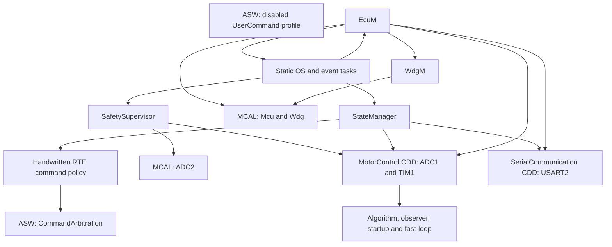

# AUTOSAR-Inspired PMSM Motor-Control Firmware for STM32G431

Ongoing personal embedded-C project for STM32G431RBTx (Cortex-M4), combining PMSM field-oriented control modules with an AUTOSAR Classic-inspired architecture. Application components communicate through a handwritten RTE-style adapter and supporting BSW services. MCAL drivers and complex drivers have separate hardware-resource responsibilities. This is not a complete or verified AUTOSAR stack.

## Project status

Control algorithms and bounded driver/service functions are implemented and host-tested. Motor-control activation remains disabled by the current configuration and command policy. Full motor operation and closed-loop hardware performance are unverified.

| Area | Status | Evidence |
| --- | --- | --- |
| Fixed-point Clarke/Park/inverse Park, PI anti-windup, normalized SVPWM | Implemented; host-tested | [Algorithm](Software/Bsw/ComplexDrivers/MotorControl/Src/MotorControlAlgorithm.c) |
| Back-EMF observer, CORDIC tracker, startup qualification and handover | Implemented; host-tested with synthetic parameters | [Observer](Software/Bsw/ComplexDrivers/MotorControl/Src/MotorControlObserver.c), [startup](Software/Bsw/ComplexDrivers/MotorControl/Src/MotorControlStartup.c) |
| Fast-loop and ADC1/TIM1 generation pipeline | Partially integrated; host-tested; activation restricted | [CDD](Software/Bsw/ComplexDrivers/MotorControl/Src/MotorControlCdd.c), [fast-loop](Software/Bsw/ComplexDrivers/MotorControl/Src/MotorControlFastLoop.c) |
| MCU, ADC2, watchdog, scheduler, state/safety supervision | Implemented bounded slices; host-tested | [Verification mapping](docs/verification.md) |
| USART2 framed protocol and session/lease handling | Implemented; host-tested; non-actuating policy | [Serial CDD](Software/Bsw/ComplexDrivers/SerialCommunication/Src/SerialCommunicationCdd.c) |
| Current snapshot on hardware and motor operation | Pending hardware validation | [Evidence limits](docs/verification.md) |
| Parameter measurement, authorized activation and commissioning | Planned | Requires separate hardware work |

## Architecture



Arrows show API dependencies, not activation. CDDs access assigned registers through CMSIS with ownership separate from MCAL. See [architecture and interfaces](docs/architecture.md).

## Repository layout

- `Software/Asw/`, `Software/Rte/`: application components and policy adapter.
- `Software/Bsw/Services/`: OS, EcuM, StateManager, SafetySupervisor and WdgM.
- `Software/Bsw/Mcal/`: MCU, ADC2 and watchdog drivers.
- `Software/Bsw/ComplexDrivers/`: motor/serial drivers and pure control cores.
- `Boot/`, `Startup/`, `Toolchain/`: entry, vectors and C runtime support.
- `Drivers/CMSIS/`: vendored dependency inputs and original licenses.
- `Tests/Host/`: existing C tests, fake registers and unchanged PowerShell runners.
- `scripts/`, `docs/`: portable host runner, compiler recipes and technical documentation.

## Build instructions

Import this directory as an existing STM32CubeIDE project into a separate workspace. Preserve the [.project](.project) name `G431_Motor_Control`; [.cproject](.cproject) contains Debug/Release configurations, source roots and includes. CMSIS and the [linker script](STM32G431RBTX_FLASH.ld) are included; no dependency download is needed.

STM32CubeIDE 2.0.0 is the documented IDE version. Import the project and build Debug or Release without launching a debug session. For headless builds, set absolute Windows-native paths to the installed wrapper, project and a separate workspace:

```powershell
$ide = 'C:\ST\STM32CubeIDE_2.0.0\STM32CubeIDE'
$project = (Get-Location).Path
$workspace = Join-Path $env:TEMP 'g431-build-workspace'
& "$ide\headless-build.bat" -data $workspace -import $project -cleanBuild G431_Motor_Control/Debug -cleanBuild G431_Motor_Control/Release
```

**Current target build is unverified.** The recorded headless attempt exited 13 during import, before compilation: Eclipse interpreted `V:/` as an unsupported URI scheme. The Windows-native path command above has not been verified successfully. See [build troubleshooting](docs/verification.md#target-build).

## Host verification

Python 3 and an existing GCC-compatible host compiler are required. From this repository root:

```sh
python3 scripts/run_host_tests.py --cc gcc
# Alternatively: CC=gcc python3 scripts/run_host_tests.py
```

The runner builds in a temporary directory and retains the original standards, optimization, include order, strict warnings and math-library flags. It includes the serial source-boundary check and UserCommand positive/negative compile probes. Original PowerShell runners retain their pinned MinGW GCC 6.3.0 configuration.

The latest 2026-10-11 Windows run compiled and executed **16 C executables**, checked nine compile probes and passed one source-boundary check using MinGW GCC 6.3.0: **42 checks passed, zero failed**. This is not a test-case count or coverage measure. Native Linux execution remains unverified. See [commands, source identity and results](docs/verification.md), [compiler recipes](scripts/host_test_manifest.json) and [latest raw output](docs/host-test-2026-10-11.txt).

## Hardware status and current limitations

Historical records describe bounded board checks with motor/power-stage supplies disconnected on earlier images. They do not establish target behavior for the current source; see [hardware evidence](docs/verification.md#hardware-evidence).

- Measurement, current-scale, control-parameter and sampling-timing approval remain `FALSE`; operational parameters/evidence digests are unpopulated in [MotorControlCdd_Cfg.c](Software/Bsw/ComplexDrivers/MotorControl/Src/MotorControlCdd_Cfg.c).
- [UserCommand](Software/Asw/UserCommand/Src/User_Command.c) defaults to disabled with zero current/duration/lease. [CommandArbitration_Evaluate](Software/Asw/CommandArbitration/Src/CommandArbitration.c) accepts only bounded zero-current requests and returns `NOT_READY`; the RTE adapter preserves that restriction. The profile getter has no production consumer.
- CDD source includes fast-loop composition, but no external production caller of `MotorControlCdd_StageControl` exists. Source integration does not confer motor authority.
- The handwritten OS/RTE services implement a limited project-specific subset. Full standard services, ECU abstraction, Com/PduR and Det/Dem stacks are not implemented here.
- Synthetic host parameters/fake registers cannot establish ADC accuracy, interrupt timing, WCET, waveforms, stability, speed or torque performance. No safety certification or production-readiness claim is made.

## Next steps (planned)

Establish reproducible target builds and native Linux host execution; identify board/motor parameters; finish activation integration; then verify electrical timing, fault response and motor operation against exact firmware images.

## Dependencies and licensing

[CMSIS provenance](Drivers/CMSIS/README.md): STM32CubeG4 V1.6.3, CMSIS Core 5.3.0, STM32G4 Device 1.2.6. Original [Core](Drivers/CMSIS/LICENSE.txt) and [Device](Drivers/CMSIS/Device/ST/STM32G4xx/LICENSE.txt) Apache-2.0 texts/notices remain unchanged. HAL/LL and AUTOSAR generators are not dependencies.

No project-wide license has been selected for the author's original code. Third-party licenses apply to their respective files.
