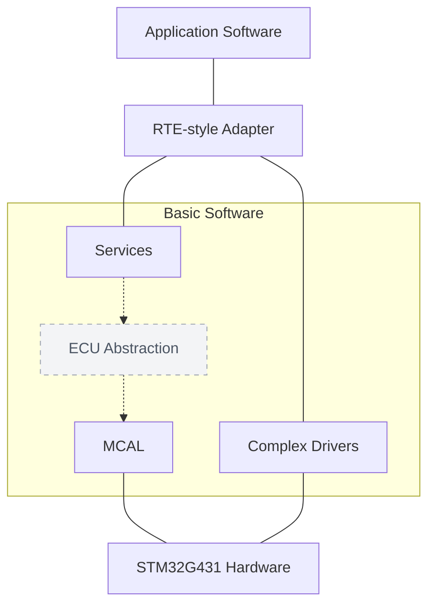

# Architecture and interfaces

The firmware uses an AUTOSAR Classic-inspired separation of application components, a handwritten RTE-style adapter, BSW services, MCAL and complex drivers. The table below describes implemented responsibilities; configuration and activation restrictions are listed separately.

## Firmware layers

Layer view, not a runtime call graph. The dashed ECU Abstraction layer is not implemented; services currently call MCAL and CDD APIs directly. The handwritten RTE adapter is limited to command policy.

The OS belongs to the Services layer. StateManager and SafetySupervisor are project-specific services. Complex Drivers form a separate BSW branch with direct access to their assigned peripherals.

### Implemented command path

StateManager calls `Rte_CommandPolicyEvaluate`, which delegates to ASW's `CommandArbitration_Evaluate`. EcuM, StateManager and SafetySupervisor also call CDD APIs directly. The adapter does not provide a generated or full AUTOSAR RTE.

### Hardware-resource ownership

| Owner | Resources |
| --- | --- |
| MCAL Mcu | Shared clocks, reset and ADC12-common setup |
| MCAL Adc | ADC2 |
| MCAL Wdg | IWDG |
| MotorControl CDD | TIM1, ADC1 and motor GPIO/BKIN |
| SerialCommunication CDD | USART2 and PA2/PA3 |

The algorithm, observer, startup and fast-loop modules reside in the MotorControl CDD source tree. Shared clock/reset ownership remains with Mcu.

## Layers and interfaces

Source links identify the implementation of each responsibility.

| Module | Responsibility and interface | Source |
| --- | --- | --- |
| ASW UserCommand | Disabled profile, compile-time limits and runtime validation | [User_Command.c](../Software/Asw/UserCommand/Src/User_Command.c) |
| ASW CommandArbitration | `CommandArbitration_Evaluate`: bounded START/SET_CURRENT validation; zero current only; NOT_READY decision | [CommandArbitration.c](../Software/Asw/CommandArbitration/Src/CommandArbitration.c) |
| RTE-style adapter | `Rte_CommandPolicyEvaluate` maps requests/decisions to the application policy | [Rte_CommandPolicy.c](../Software/Rte/Src/Rte_CommandPolicy.c) |
| EcuM | Safe initialization order, boot checkpoints and one-way supervision handoff | [EcuM.c](../Software/Bsw/Services/EcuM/Src/EcuM.c) |
| OS | Static tasks/priorities, events, SysTick, guarded stacks and exception port | [Os.c](../Software/Bsw/Services/Os/Src/Os.c), [Os_Cfg.c](../Software/Bsw/Services/Os/Src/Os_Cfg.c), [Os_Port.S](../Software/Bsw/Services/Os/Src/Os_Port.S) |
| StateManager | State/fault aggregation and command-response ownership | [StateManager.c](../Software/Bsw/Services/StateManager/Src/StateManager.c) |
| SafetySupervisor | ADC2 safety sampling, fault latching, READY interlock and fast safety publication | [SafetySupervisor.c](../Software/Bsw/Services/SafetySupervisor/Src/SafetySupervisor.c) |
| WdgM / Wdg | Alive/checkpoint supervision and controlled IWDG refresh | [WdgM.c](../Software/Bsw/Services/WdgM/Src/WdgM.c), [Wdg.c](../Software/Bsw/Mcal/Wdg/Src/Wdg.c) |
| MCAL Mcu / Adc | Clock/reset, startup validation, ADC12-common setup and ADC2 polling API | [Mcu.c](../Software/Bsw/Mcal/Mcu/Src/Mcu.c), [Mcu_Adc12.c](../Software/Bsw/Mcal/Mcu/Src/Mcu_Adc12.c), [Adc.c](../Software/Bsw/Mcal/Adc/Src/Adc.c) |
| Motor CDD | TIM1, ADC1, motor GPIO/BKIN, safe output, calibration and generation-tagged acquisition/compare pipeline | [MotorControlCdd.c](../Software/Bsw/ComplexDrivers/MotorControl/Src/MotorControlCdd.c) |
| Serial CDD | USART2/PA2/PA3, framed parser, RX ring, sessions/leases and mailbox exchange | [SerialCommunicationCdd.c](../Software/Bsw/ComplexDrivers/SerialCommunication/Src/SerialCommunicationCdd.c) |

`UserCommand_GetProfile` has no production consumer in the current source. `Rte_CommandPolicyEvaluate` calls `CommandArbitration_Evaluate`; the application policy does not depend on the adapter.

Mcu owns shared clock/reset setup; motor ADC1 and MCAL ADC2 have distinct owners. Application code stays above hardware headers. Common AUTOSAR-style types/macros are under `Bsw/Common/Inc`. The serial CDD has no direct MotorControl, StateManager or OS service dependency; the host runner checks that boundary.

## Control cores and integration

[MotorControlAlgorithm.c](../Software/Bsw/ComplexDrivers/MotorControl/Src/MotorControlAlgorithm.c) implements `MotorControlAlgorithm_Clarke`, `Park`, `InversePark`, `PiStep` and `Svpwm`. Bounded integer fixed-point representations are used. PI has a Q30 integrator and conditional integration/clamping for anti-windup. Normalized SVPWM returns mathematical duty/sector results; these are not measured PWM outputs.

[MotorControlObserver.c](../Software/Bsw/ComplexDrivers/MotorControl/Src/MotorControlObserver.c) implements back-EMF estimation, normalized CORDIC tracking, rolling speed-quality checks and reliability/lifecycle outputs. [MotorControlStartup.c](../Software/Bsw/ComplexDrivers/MotorControl/Src/MotorControlStartup.c) implements alignment/open-loop phases, observer qualification, blended handover, bounded references and stop/fault precedence. Test configurations are synthetic, not identified motor parameters.

[MotorControlFastLoop.c](../Software/Bsw/ComplexDrivers/MotorControl/Src/MotorControlFastLoop.c) composes these cores through `MotorControlFastLoop_Init`, `Begin` and `Step`, with sine/cosine and fail-closed publication. The CDD's `MotorControlCdd_StageControl` prepares control state; ADC JEOS processing calls `MotorControlFastLoop_Step` and guards compare commits by generation and timing. TIM1 Update arms acquisition; break/error paths force safe output. Defaults deny activation, and no external production StageControl caller exists. This is partial source integration, not operational motor evidence.

`MotorControlCdd_StartCalibration`, `CalibrationStep` and cleanup implement non-actuating U/U/V/V/W/W accept-second sampling, retaining 64 samples per phase. Unapproved measured configuration cannot install operational readiness. Immutable configuration getters reject invalid/corrupt identity and parameter representations.

## Scheduling, communication and faults

Static tasks are Idle, Safety, State and EcuM/supervision. SysTick releases Safety/State every 1 ms and supervision every 10 ms. Extended-task wrappers wait for and clear events before calling the assigned service. SVC/PendSV assembly saves/restores task context; BASEPRI critical sections and stack guards are implemented. Host checks do not execute ARM context-switch assembly or establish interrupt nesting/timing.

The serial CDD configures USART2 at 115200 8-N-1, receives through a bounded SPSC ring and parses 28-byte little-endian CRC-CCITT-FALSE frames. It checks session challenge/bind, sequence, lease, rate limits and mailbox ownership. StateManager obtains decisions through RTE/ASW. Transport acceptance does not grant actuation; current START/SET_CURRENT policy remains non-actuating.

Fault producers publish detailed events and critical interlock classes. Safety/State aggregate faults and gate READY. WdgM refresh depends on its supervision lifecycle. Emergency-off is a distinct low-level path used by boot/fatal/clock/motor faults. These mechanisms still require target/electrical evidence.

## AUTOSAR-inspired scope and inferred trade-offs

Layer naming, static configuration, standard-style types, service lifecycles, event tasks and the RTE-style boundary reflect AUTOSAR Classic concepts. The adapter and supporting services are handwritten. A full standard OS/BSW stack, ARXML workflow and configuration tools are absent. ECU abstraction, Com/PduR and Det/Dem directories contain placeholders rather than implemented stacks.

The following trade-offs are inferred from the code:

- Pure integer cores permit host mathematical checks independently of hardware; target timing and motor identification remain separate.
- Direct-register CDD ownership exposes ADC1/TIM1 sequencing but couples the driver to STM32G431 behavior.
- Static tasks and bounded mailboxes constrain memory/work while providing fewer services than a full AUTOSAR implementation.
- Fail-closed defaults separate source integration from activation, so host PASS does not enable motor operation.
